<div align="center">



<!-- LUNA LAB CORP. | MATRIX x MR. ROBOT -->

<div align="center">

<a href="https://github.com/lunalab2026">
  
</a>

<br/>

[](https://github.com/lunalab2026?tab=followers)
&nbsp;
[](https://github.com/lunalab2026)
&nbsp;
[](https://github.com/lunalab2026)


<h3><code>&gt; choose --pill</code></h3>

<a href="https://github.com/lunalab2026?tab=repositories"></a>
<a href="https://linkedin.com/in/davidsonluna"></a>

</div>

---

<h3 align="center"><code>&gt; whoami</code></h3>

<div align="center">
  
</div>

<h3 align="center"><code>&gt; cat stack.txt</code></h3>

<p align="center">


</p>

<h3 align="center"><code>&gt; git log --stats</code></h3>

<div align="center">
  
</div>

<p align="center">
  
</p>

<details>
<summary align="center"><code>&gt; man git-stats</code> &nbsp;(relatório completo)</summary>
<br />
<div align="center">
  
  <br />
  
  
</div>
</details>

<h3 align="center"><code>&gt; watch --live git contributions</code></h3>


<div align="center">

<details>
<summary>🐇 <b>Follow the white rabbit...</b></summary>
<br />

<table align="center">
<tr>
<td>

```bash
┌──────────────────────────────────────────────────────────┐
│  [ ACCESS ]   > acesso concedido                         │
│  [ MISSION ]  > Você é o escolhido: faça um git commit   │
│  [ FOCUS ]    > código · IA · automação · agentes        │
│  [ MOTTO ]    > "Não existe colher. Só existe código."   │
│  [ STATUS ]   ██████████████████░░  compilando...        │
└──────────────────────────────────────────────────────────┘
```

</td>
</tr>
</table>

</details>

<br/>


</div>
